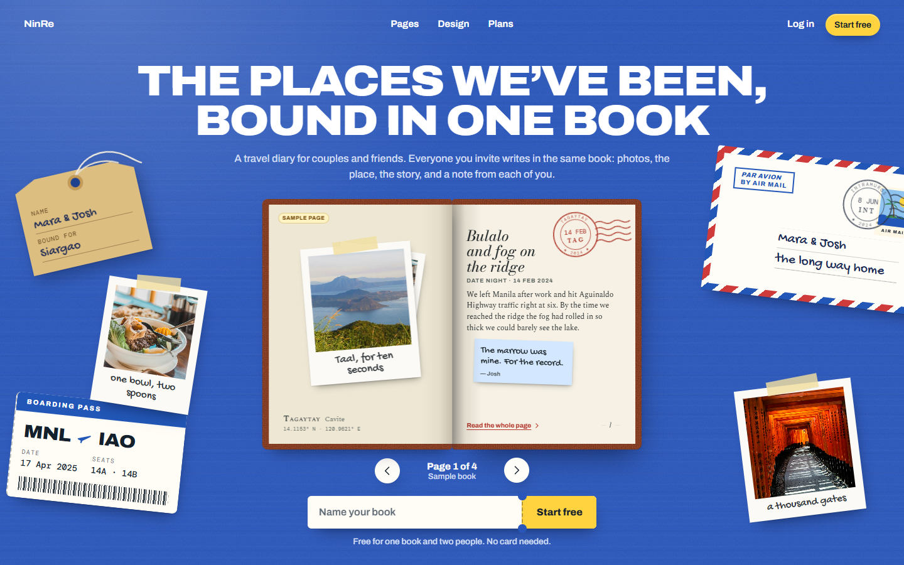
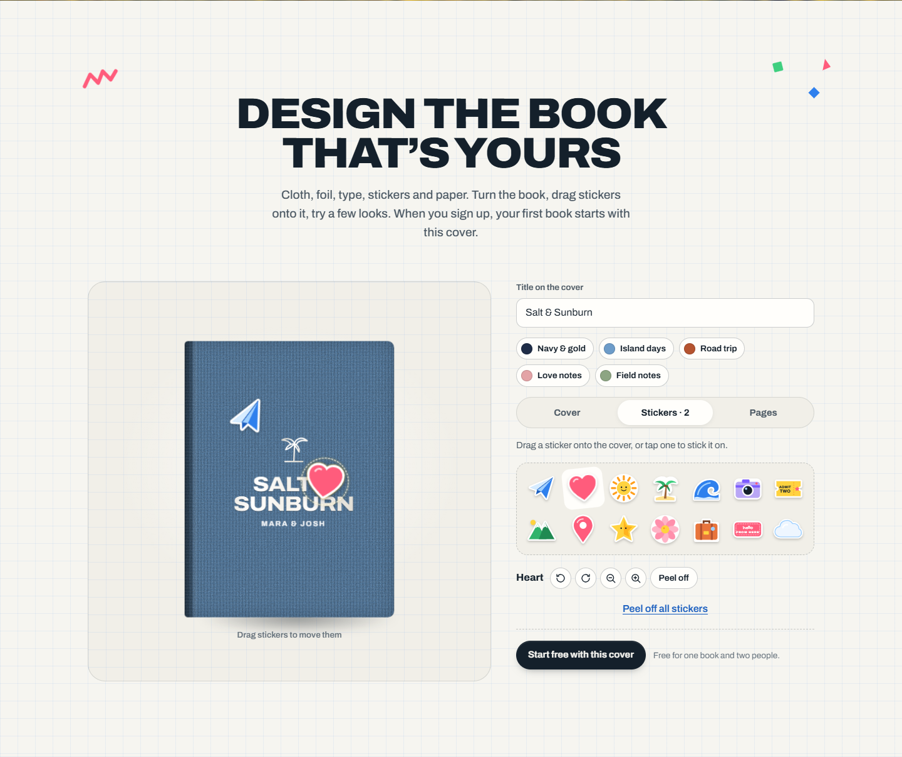
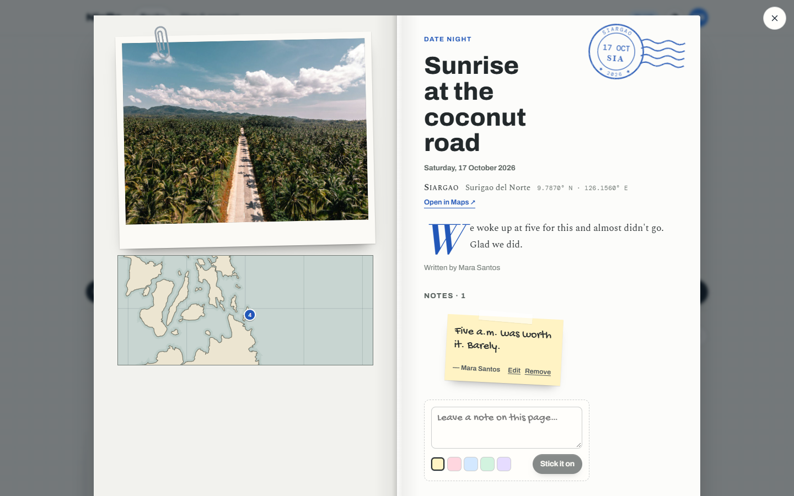

# NinRe

A travel diary for couples and friends, built as a book. Everyone you invite writes in the same book. Each page holds photos, a pin on the book's own atlas, the date, the story of the day, a postmark, and short notes from each person. Pages gather into chapters by year. The book's cover and paper can be designed: cloth, foil, type, emblem, stickers, paper, photo style and ink.



## What's inside

| Part | What it does |
| --- | --- |
| **Website** (`/`) | A travel desk with the sample book in the middle: open it and turn its pages (drag, tap or arrow keys). Below that are the sample pages pinned on a map, the cover designer, the plans as tickets and the FAQ. Every section is paper on the same table. The book's cover follows the designer, and that cover becomes the first book's cover after sign-up. |
| **Accounts** | Email and password. Sessions are HTTP-only cookies; passwords are hashed with scrypt. Change your name or password, or delete the account. |
| **Shelf** (`/app`) | Every book you own or write in, shown as covers. Free allows one book. |
| **Book** (`/app/book/:id`) | A turnable copy of the designed book beside the title, names, day counter and ledger. Read it as **Chapters** (one per year), an **Atlas** (numbered pins and a dashed route), or an **Album** (every photo). Open any page as a two-page spread with its sticky notes. |
| **Designer** (`/app/book/:id/design`) | Live 3D book. Cover: cloth (12 colours or any colour), finish, foil, title type, layout, emblem, a cover photo from the book. Stickers: drag them onto the cover, then move, turn, resize or peel them off (keyboard works too). Pages: paper, photo style and ink, previewed on a real page. Saves itself. |
| **People** | Invite links (14 days, owner only), members, leaving a book. The owner's plan sets how many people fit. |
| **Plan & account** (`/app/account`) | Plan, usage meters, prepaid checkout through PayMongo, payment history. |



Also included:
- Light and dark themes for the app. The website stays in its daylight palette.
- An offline read-only copy of each book on each device.
- Press **N** in a book to start a new page.
- Four sample pages, labelled as samples, fill an empty book and disappear when the first real page is added.



## Plans and payments

| Plan | Price | Books | People per book | Photos |
| --- | --- | --- | --- | --- |
| Free | ₱0 | 1 | 2 | 300 |
| Plus | ₱199 a month | unlimited | 6 | 5,000 |
| Crew | ₱449 a month | unlimited | 20 | 25,000 |

The limits live in [server/src/plans.ts](server/src/plans.ts). Photo allowances count every photo across the books a person owns.

Payments use PayMongo's hosted **Checkout Sessions** (cards, GCash, Maya; PHP only). A checkout session is a one-off payment, so plans are **prepaid**: people pay for 1, 6 or 12 months, and nothing renews by itself. The app shows a reminder in the last week. When paid time runs out, the owner's books drop to Free limits. Nothing is deleted; adding books, people or photos past those limits waits until they renew. Paying again for the same plan extends it. Switching plans starts the new one at once and converts the unused days at the price ratio.

Without a PayMongo key, upgrades go through a labelled **test checkout** inside the app, and no money moves.

### Connecting PayMongo

1. Put your secret key in `PAYMONGO_SECRET_KEY` (`sk_test_…` while testing, `sk_live_…` for real payments).
2. In the PayMongo dashboard, add a webhook pointing to `https://your-domain/api/billing/webhook` for the event `checkout_session.payment.paid`. Copy its secret into `PAYMONGO_WEBHOOK_SECRET`.
3. Set `APP_URL` to your public address, so PayMongo sends people back to the right place.
4. Enable the payment methods you list in `PAYMONGO_METHODS` on your PayMongo account.

A payment is confirmed two ways: by the signed webhook, and by asking PayMongo directly when the person comes back from checkout. Either one is enough, and confirming twice changes nothing.

## Quick start

You need **Node.js 22.18 or newer** (24 recommended). The server runs TypeScript directly and uses Node's built-in SQLite, so the server has no build step and nothing native to compile.

```bash
npm install
npm run dev
```

Open http://localhost:5173. The API runs on http://localhost:4000, and Vite proxies `/api` and `/uploads` to it.

To run it the way it runs in production, as one server for the API and the built web app:

```bash
npm run build
npm start          # http://localhost:4000
```

## Configuration

Copy `.env.example` to `.env`. Every value is optional.

| Variable | Default | Purpose |
| --- | --- | --- |
| `PORT` | `4000` | Port for the API and, after a build, the web app. |
| `DATA_DIR` | `./data` | Where `ninre.sqlite` and the `uploads/` folder live. Point it at a persistent disk when you deploy. |
| `APP_URL` | *(from the request)* | Public address used in PayMongo return links, e.g. `https://ninre.app`. |
| `PAYMONGO_SECRET_KEY` | *(empty)* | Turns on real checkout. Empty means the labelled test checkout. |
| `PAYMONGO_WEBHOOK_SECRET` | *(empty)* | Verifies `Paymongo-Signature` on webhooks. Empty means webhooks are refused, and payments are confirmed when people return from checkout. |
| `PAYMONGO_METHODS` | `card,gcash,paymaya` | Payment methods offered at checkout. |

The earlier single-book version kept its data in `DATA_DIR/book.sqlite` with a shared passcode. NinRe uses a new database file, `ninre.sqlite`, and accounts, so the old file is left untouched and unused.

## Deploying

**Docker**

```bash
docker build -t ninre .
docker run -p 4000:4000 -e APP_URL=https://your-domain -e PAYMONGO_SECRET_KEY=sk_live_… -e PAYMONGO_WEBHOOK_SECRET=whsk_… -v ninre-data:/data ninre
```

**Render, Railway, Fly.io and similar hosts.** Use the Dockerfile, or run `npm install && npm run build` to build and `npm start` to start. Attach a persistent disk or volume and set `DATA_DIR` to its mount path. Without one, the database and photos are lost on every redeploy.

The server trusts one proxy hop (`trust proxy = 1`), so session cookies are marked `Secure` behind an HTTPS load balancer.

**Backups.** Everything lives in `DATA_DIR`. Stop the server, or run `sqlite3 ninre.sqlite ".backup backup.sqlite"`, then copy the database together with `uploads/`.

## How it works

```
client/   React 19 + TypeScript + Vite
  src/
    App.tsx            routes
    router.tsx         a small history router
    session.tsx        who is signed in
    api.ts             typed fetch client
    marketing/         the website: Landing, doodles, landing.css
    auth/              sign up, log in, invite links, test checkout styles
    app/               shell, shelf, book reader, designer, people, plan & account, test checkout
    book/              the design system for books: design.ts, CoverFace, Book3D, stickers, emblems,
                       CoverDesigner, PagePreview
    views/             Chapters, AtlasView, Album
    dialogs/           PageSpread (with notes), PageForm, CoverForm
    components/        BookHeader, Stamp, Polaroids, Notes, Avatar, Icon, Dialog, Toast, ThemeToggle
    map/               atlas.ts (map engine), AtlasMap.tsx, MapDefs.tsx
    lib/               book shelving, formatting, places, samples, image resizing, pending design
    styles/            tokens, base, book materials, pages, atlas, dialogs, designer, app
  public/img, public/samples   photographs (see Photo credits)
  public/map/world.json        coastlines and borders, pre-projected
server/   Express 5 + node:sqlite + Multer
  src/
    index.ts           reads the environment and starts the server
    app.ts             app factory: security headers, routes, private photos, static files, errors
    db.ts              schema and queries
    auth.ts            scrypt passwords, sessions, rate limits, membership checks
    plans.ts           plans, prices and limits
    design.ts          book design validation
    paymongo.ts        checkout sessions, payment checks, webhook signatures; the test checkout
    validate.ts        input validation
    routes/            auth & account, books (pages, photos, notes, people, invites), billing
  test/api.test.ts     end-to-end API tests (node:test)
tools/build-map.mjs    regenerates world.json from Natural Earth
```

**Privacy.** Books are visible only to their members. Photos are stored per book under `uploads/<book id>/` and served only to signed-in members of that book. State-changing requests from other sites are refused.

**Photos.** The browser resizes each photo to 1600 px and encodes it as JPEG, then uploads it. The server checks the file's real bytes against its type and stores it under a random name. Photos dropped from a page are deleted when the page is saved. Uploads that never reach a page are cleaned up after 24 hours.

**Map.** There are no map services or API keys. Coastlines come from [Natural Earth](https://www.naturalearthdata.com/) (public domain) via `world-atlas`, pre-projected to compact SVG paths by `tools/build-map.mjs`.

### API

| Method | Path | Notes |
| --- | --- | --- |
| `GET` | `/api/me` | `{ user: null }`, or the user with their books and plan |
| `POST` | `/api/auth/signup`, `/api/auth/login`, `/api/auth/logout` | |
| `PUT` / `DELETE` | `/api/account`, `/api/account/password` | name, password, delete (needs the password) |
| `GET` | `/api/plans` | public: plans, prices, provider |
| `GET` / `POST` | `/api/billing`, `/api/billing/checkout` | plan state; start a checkout `{ plan, months }` |
| `GET` / `POST` | `/api/billing/payments/:id`, `…/sync`, `…/test-pay` | a payment; confirm with PayMongo; pay a test checkout |
| `POST` | `/api/billing/webhook` | PayMongo, signed |
| `POST` | `/api/books` | create `{ title, subtitle, since, sinceLabel, design }` |
| `GET` / `DELETE` | `/api/books/:id` | read (members); delete (owner) |
| `PUT` | `/api/books/:id/cover`, `/api/books/:id/design` | |
| `GET` / `DELETE` | `/api/books/:id/people`, `/api/books/:id/people/:userId` | members and invites; remove or leave |
| `POST` / `DELETE` | `/api/books/:id/invites`, `/api/books/:id/invites/:code` | owner only |
| `GET` / `POST` | `/api/invites/:code`, `/api/invites/:code/accept` | public preview; join |
| `POST` | `/api/books/:id/photos` | multipart: `width`, `height`, then `photo` |
| `POST` / `PUT` / `DELETE` | `/api/books/:id/pages`, `/api/books/:id/pages/:pageId` | |
| `POST` / `PUT` / `DELETE` | `/api/books/:id/pages/:pageId/notes`, `…/notes/:noteId` | notes; only the writer edits, the owner can remove |

A limit reached on the owner's plan answers `402` with a message, and the app offers an upgrade.

## Scripts

| Command | Does |
| --- | --- |
| `npm run dev` | API with reload, plus the Vite dev server |
| `npm run build` | Typechecks and builds the web app into `client/dist` |
| `npm start` | Serves the API and the built app |
| `npm test` | Runs the API tests against a temporary database |
| `npm run typecheck` | Typechecks server and client |

## Photo credits

The website and sample pages use photographs from [Unsplash](https://unsplash.com) under the Unsplash License. Each file also carries its source in its JPEG comment.

| File | Photo |
| --- | --- |
| `img/hero.jpg`, `img/hero-blur.jpg` | [Green grass field under blue sky](https://unsplash.com/photos/green-grass-field-under-blue-sky-and-white-clouds-during-daytime-EACiHThPgjQ) |
| `img/bloom.jpg` | [A field of yellow flowers](https://unsplash.com/photos/a-field-of-yellow-flowers-with-a-mountain-in-the-background-HuSoGxW-vIs) |
| `samples/taal.jpg` | [A lake and mountains from a hilltop](https://unsplash.com/photos/a-view-of-a-lake-and-mountains-from-the-top-of-a-hill-5_E6W06YQfQ) |
| `samples/bulalo.jpg` | [Cooked food in a white bowl](https://unsplash.com/photos/cooked-food-on-white-ceramic-bowl-PAynGzC2hME) |
| `samples/fort-santiago.jpg` | [A stone gate](https://unsplash.com/photos/a-stone-gate-with-a-clock-tower-in-the-background-TBDUapl7H_4) |
| `samples/kalesa.jpg` | [A horse-drawn carriage](https://unsplash.com/photos/a-horse-drawn-carriage-on-a-city-street-HIOm2zotfcE) |
| `samples/siargao-road.jpg` | [Coconut trees under blue sky](https://unsplash.com/photos/clllGLYtLRA) |
| `samples/siargao-palms.jpg` | [Palm trees on a beach](https://unsplash.com/photos/S2fycLbjBQA) |
| `samples/kyoto-torii.jpg` | [Torii gates in Kyoto](https://unsplash.com/photos/torii-gates-in-kyoto-EJvGBYjrwEA) |
